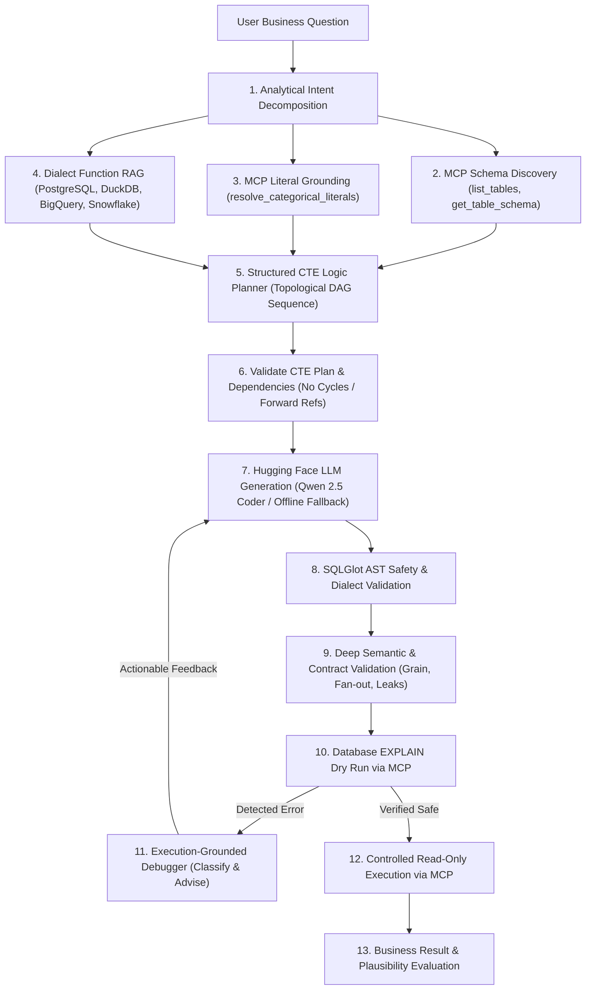

# Enterprise Text-to-SQL Using MCP, PostgreSQL, Two-Stage Schema Linking & Hugging Face

An enterprise-grade Text-to-SQL system built using the **Model Context Protocol (MCP)**, **PostgreSQL**, **DuckDB**, **ChromaDB + BGE Embeddings**, and open-source **Hugging Face** models, targeting two core Spider 2.0 failure categories:
- **Problem 1: Erroneous Data Analysis (35.5% of Spider 2.0 errors)** — structured CTE Logic Planner, Dialect Function RAG, SQLGlot AST & Semantic Validation, Execution-Grounded Debugger.
- **Problem 2: Enterprise Schema Linking (27.6% of Spider 2.0 errors)** — Two-Stage Schema Retriever (Coarse Table + Fine Column), Nested Schema Tree Flattener (`STRUCT`/`ARRAY`/`JSON`), DB-Evidenced Distinct Value Indexer, and Schema Context Builder.

---

## 1. Problem 1 Overview: Erroneous Data Analysis

In the Spider 2.0 benchmark, **35.5% of real-world text-to-SQL failures** stem from *Erroneous Data Analysis*.

### Core Concept: Execution Success $\neq$ Analytical Correctness
A SQL query can execute successfully with zero syntax errors (`HTTP 200 / Status: SUCCESS`), yet produce a completely distorted business result due to:
1. **Grain & Counting Mismatches**: Counting row/event occurrences (`COUNT(*)`, `COUNT(event_id)`) instead of distinct entities (`COUNT(DISTINCT user_id)`).
2. **Filter Misplacement**: Placing date predicates on a `LEFT JOIN` in the `WHERE` clause, inadvertently converting it into an `INNER JOIN` and dropping the churned cohort from the denominator.
3. **Cartesian Fan-Out / Join Multiplication**: Joining unaggregated transactional tables directly, multiplying rows and distorting financial metrics into billions.
4. **Denominator Distortion**: Dividing returning users by active users or activity events instead of the baseline signup cohort.
5. **Division-by-Zero Crashes**: Dividing without guarding the denominator with `NULLIF(col, 0)`.
6. **Dialect Function Syntax Misuse**: Using dialect-incompatible functions (e.g. `QUALIFY` or `DATEDIFF` on PostgreSQL, or inverted argument orders in `DATE_DIFF`).

---

## 2. Complete Architecture



---

## 3. Project Structure

```
text2SQL-MCP/
├── src/
│   ├── __init__.py            # Package root & exposed modules
│   ├── config.py              # Pydantic Settings (PostgreSQL, HF, BGE embeddings & ChromaDB)
│   ├── db.py                  # PostgreSQL connection factory (60s timeout & read-only session) + SQLite
│   ├── schema_inspector.py    # Multi-schema inspector (PostgreSQL, DuckDB, SQLite), PK/FK & sample rows
│   ├── table_retriever.py     # Stage 1 Coarse Table Retriever (BGE + ChromaDB, multi-schema, refresh)
│   ├── column_retriever.py    # Stage 2 Fine-Grained Column & Nested Field Retriever (PK/FK preserved)
│   ├── schema_flattener.py    # Stage 3 Nested Schema Tree Flattener (STRUCT, ARRAY, JSON/JSONB)
│   ├── literal_resolver.py    # Stage 4 DB-Evidenced Distinct Value Indexer & Categorical Resolver
│   ├── schema_context_builder.py # Stage 5 Pruned SchemaContext Builder & EnterpriseSchemaRetriever
│   ├── dialect_rag.py         # Dialect Function RAG (PostgreSQL, DuckDB, BigQuery, Snowflake, SQLite)
│   ├── cte_planner.py         # Structured CTE Logic Planner (schema-linked DAG models & compiler)
│   ├── hf_client.py           # Hugging Face Inference API / Dedicated Endpoint Client
│   ├── sql_validator.py       # SQLGlot AST security, DDL/DML rejection, and dialect gates
│   ├── semantic_validator.py  # Diagnoses business logic pitfalls (grain, join leaks, fan-out, bounds)
│   ├── debugger.py            # Execution-grounded debugging loop with error classification & repair
│   ├── sql_generator.py       # Integrates Two-Stage Schema Linking, CTE Planner, RAG & HF generation
│   ├── mcp_server.py          # Official MCP Server with 8 database & schema-linking tools
│   ├── query_executor.py      # Official MCP Client layer wrapping tool invocation
│   ├── evaluator.py           # Problem 1 (10 failure modes) & Problem 2 (7 retrieval metrics) Evaluators
│   └── cli.py                 # Interactive Rich terminal REPL (Problem 1 + Problem 2 evaluation)
├── scripts/
│   ├── inspect_database.py    # Schema inspector utility for PostgreSQL
│   ├── seed_test_data.py      # Populates the 120-user January/February retention benchmark
│   └── run_demo.py            # End-to-end demonstration comparing Baseline vs Improved vs Debugger
├── tests/
│   ├── conftest.py            # Pytest configuration & environment availability detector
│   ├── test_cte_planner.py    # Unit tests for CTE plan creation, DAG validation, and compilation
│   ├── test_dialect_rag.py    # Unit tests for dialect function retrieval and syntax validation
│   ├── test_hf_generation.py  # Unit tests for Hugging Face prompt construction and SQL extraction
│   ├── test_debugger.py       # Unit tests for error taxonomy, repair guidance, and self-repair loop
│   ├── test_problem1_regression.py # 10-test Spider 2.0 benchmark suite measuring execution vs analytical correctness
│   ├── test_sql_validator.py  # AST checks rejecting DDL, DML, multi-statements, and dialect violations
│   ├── test_semantic_analysis.py # Semantic tests for grain, filter leaks, fan-out, and bounds
│   ├── test_mcp_tools.py      # Tests discovery and execution of MCP tools
│   ├── test_literal_resolver.py # Tests categorical literal resolution
│   ├── test_schema_flattener.py # Tests STRUCT/ARRAY/JSON flattening & live DuckDB UNNEST semantics
│   ├── test_schema_linking.py   # Tests Two-Stage retrieval, DB-evidenced literals, BGE & MCP integration
│   ├── test_problem2_eval.py    # Tests 7 Stage-7 retrieval metrics, 250+ columns & live schema refresh
│   └── test_db_connection.py  # Live PostgreSQL and local SQLite connectivity tests
├── .env.example               # Sanitized template with PostgreSQL and Hugging Face settings
├── requirements.txt           # Verified dependencies (mcp, sqlglot, huggingface-hub, psycopg2, pydantic, rich, pytest)
└── README.md                  # Comprehensive architectural guide
```

---

## 4. Setup and Installation

### 4.1 Prerequisites
- Python 3.10+ (Tested on Python 3.14)
- Hugging Face account (for live inference using Qwen 2.5 Coder or similar)
- Access to PostgreSQL or local SQLite test database (included)

### 4.2 Install Dependencies
```bash
pip install -r requirements.txt
```

### 4.3 Configure Environment Variables
Copy `.env.example` to `.env` and fill in your settings:
```bash
cp .env.example .env
```
Example `.env`:
```ini
# Database Configuration
TEXT2SQL_POSTGRES_HOST=35.200.180.162
TEXT2SQL_POSTGRES_PORT=5432
TEXT2SQL_POSTGRES_USER=t2sql_reader
TEXT2SQL_POSTGRES_PASSWORD=your_password_here
TEXT2SQL_POSTGRES_DB=lending_sample
TEXT2SQL_POSTGRES_SSLMODE=require

# Hugging Face LLM Configuration
TEXT2SQL_LLM_BACKEND=huggingface
TEXT2SQL_LLM_MODEL=Qwen/Qwen2.5-Coder-32B-Instruct
# Hugging Face API Key (set HF_API_KEY, HF_TOKEN, or TEXT2SQL_HF_API_TOKEN):
HF_API_KEY=hf_your_token_here
```

---

## 5. Execution Commands

### 1. Run the Automated Problem 1 Demonstration
```bash
python scripts/run_demo.py
```
*(or `python main.py --demo`)*  
Executes:
1. Benchmark Ground Truth dynamic calculation from raw database records.
2. Naive Baseline pipeline showing the 100.0% failure mode.
3. Improved CTE Planner pipeline returning exact 30.0% ground truth.
4. Execution-Grounded Debugger verifying and dry-running execution.

### 2. Launch the Interactive Terminal Console (CLI Mode)
```bash
python main.py
```
Interactive REPL supporting:
- Natural Language Question evaluation with side-by-side SQL diffs.
- Categorical Literal Grounding via MCP.
- Direct SQL execution sandbox with real-time AST safety validation.
- Live table exploration and colorized comparison tables.

### 3. Run the Automated Test Suite
```bash
python -m pytest tests/ -v
```
Runs 69 automated tests verifying:
- CTE Logic Planner DAG validation, Pydantic schemas, and SQL compilation.
- Dialect Function RAG retrieval across PostgreSQL, BigQuery, Snowflake, and DuckDB.
- Hugging Face prompt assembly and SQL extraction.
- SQLGlot AST security (DDL/DML rejection, multi-statement injection blocking).
- Semantic analysis (distinct entity grain, join fan-out, filter leaks, safe division).
- Debugging loop error classification, repair guidance, and self-repair.
- All 10 analytical regression benchmark test cases.

---

## 6. Demonstration Summary: Baseline vs. Improved

| Dimension | Pipeline A (Naive Baseline) | Pipeline B (Improved CTE Planner + MCP) |
| :--- | :--- | :--- |
| **Strategy** | Monolithic query with raw event counting and WHERE on LEFT JOIN | 4-step topological CTE plan isolating cohort, denominator, and returning users |
| **Generated SQL** | `COUNT(e.event_id) * 100.0 / COUNT(u.user_id)` | `WITH jan_signup_cohort AS (...), distinct_jan_users AS (...), feb_returning_cohort AS (...), retention_metrics AS (...) SELECT ROUND((returning_feb_users * 100.0) / NULLIF(total_jan_signups, 0), 2)` |
| **SQL Execution** | SUCCESS (0 errors) | SUCCESS (0 errors) |
| **Returned Result** | **100.0%** (Distorted) | **30.0%** (Exact Match) |
| **Ground Truth** | **30.0%** | **30.0%** |
| **Absolute Error** | **70.00%** (Failure) | **0.00%** (Exact Match) |
| **Semantic Status** | FAILED (Grain Mismatch, Filter Misplacement Trap) | PASSED (Semantically Sound & Verified) |
| **Safe Math** | Missing `NULLIF` (Risk of division-by-zero) | Guarded with `NULLIF(total_jan_signups, 0)` |
| **Debugging Loop** | None | Classified, verified dry-run, controlled safe execution |

---

## 7. The 10 Spider 2.0 Analytical Failure Modes Addressed

1. **Distinct Entity Counts vs. Event Counts**: Enforces `COUNT(DISTINCT entity)` instead of `COUNT(*)` or `COUNT(event_id)` to avoid repeat-activity count explosion.
2. **Incorrect Aggregation Order**: Pre-aggregates intermediate tables in independent CTEs before computing ratios or aggregations.
3. **Cartesian Join Multiplication (Fan-Out)**: Detects and prevents unaggregated joins between multiple one-to-many tables.
4. **Incorrect Denominator Selection**: Explicitly defines cohort denominator CTEs independent of activity records.
5. **LEFT JOIN Filter Misplacement**: Evaluates activity conditionally inside projections to prevent discarding non-returning cohort members in the WHERE clause.
6. **Running Totals**: Enforces explicit window framing (`ROWS BETWEEN UNBOUNDED PRECEDING AND CURRENT ROW`).
7. **Moving Averages**: Enforces sliding window framing (`ROWS BETWEEN N PRECEDING AND CURRENT ROW`).
8. **Percentile Calculations**: Employs dialect-specific percentile functions (`percentile_cont(...) WITHIN GROUP (ORDER BY ...)`).
9. **Date & Time-Window Boundaries**: Uses half-open intervals `[start, end)` (`col >= '2024-01-01' AND col < '2024-02-01'`) to avoid end-of-day timestamp omissions.
10. **Dialect-Specific Function Differences**: Uses Dialect Function RAG to guide the LLM and block dialect-incompatible functions (`QUALIFY` on PostgreSQL, argument inversion in `DATE_DIFF`).

---

## 8. Problem 2: Two-Stage Enterprise Schema Linking Architecture

1. **Stage 1 — Coarse Table Retrieval (`src/table_retriever.py`)**: Embeds table names, descriptions, PK/FK summaries, and column overviews into ChromaDB using `BAAI/bge-small-en-v1.5`, supporting multi-schema `where` filtering, normalized similarity scores, and `refresh_index()`.
2. **Stage 2 — Fine-Grained Column & Nested Field Retrieval (`src/column_retriever.py`)**: Ranks columns and flattened subpaths strictly within Stage-1 candidate tables while automatically preserving Primary Keys and Foreign Keys (`preserved_as_key=True`).
3. **Stage 3 — Nested Schema Tree Flattener (`src/schema_flattener.py`)**: Recursively parses BigQuery `STRUCT<...>` / `ARRAY<...>`, DuckDB `STRUCT(...)` / `[]`, and PostgreSQL `JSON` / `JSONB` payloads while marking non-selectable paths (`is_directly_queryable=False`) with dialect-specific access hints (`UNNEST`, `LATERAL FLATTEN`, `->>`, `json_extract`).
4. **Stage 4 — DB-Evidenced Distinct Value Indexer (`src/literal_resolver.py`)**: Samples distinct database cell values via parameterized queries, resolves natural-language terms and abbreviations (e.g. `"California"` -> `'CA'`) only when backed by observed storage evidence (`require_db_evidence=True`), and validates identifiers before emitting predicates.
5. **Stage 5 — Schema Context Builder (`src/schema_context_builder.py`)**: Prunes enterprise schemas (20+ tables / 250+ columns) down to a compact Markdown & structured `SchemaContext` fed directly to `CTEPlanner` and Hugging Face `SQLGenerator`.
6. **Stage 6 & 7 — MCP Integration & Retrieval Evaluation (`src/mcp_server.py`, `src/evaluator.py`)**: Adds `get_table_relationships` and `retrieve_schema_context` MCP tools alongside `Problem2RetrievalEvaluator` measuring Table Recall@K, Column Recall@K, Precision@K, MRR, schema token reduction %, retrieval latency, and literal resolution accuracy.
